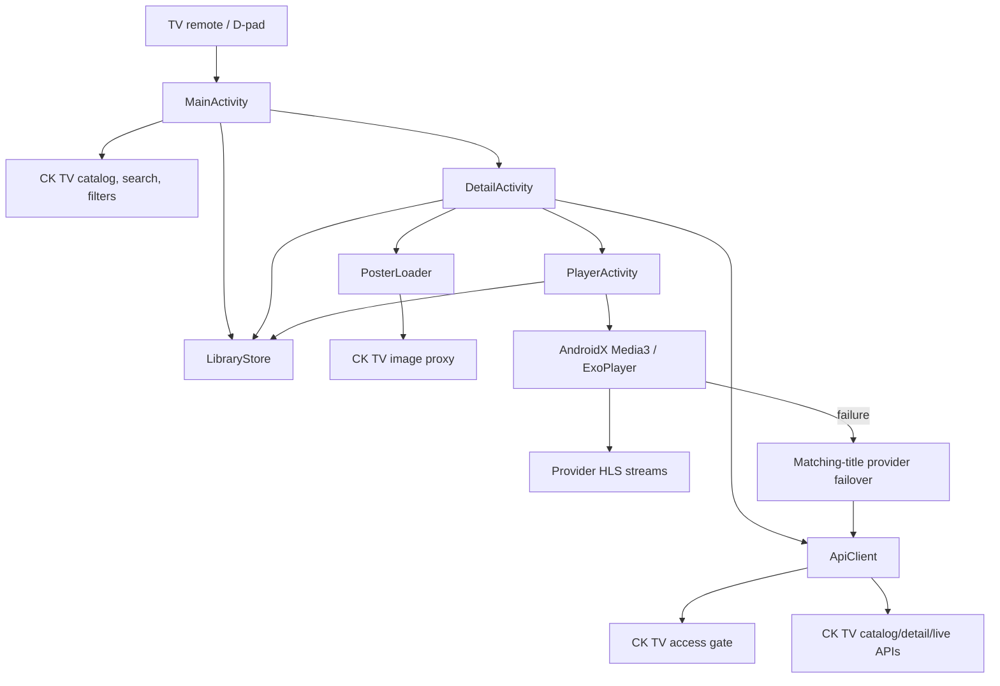
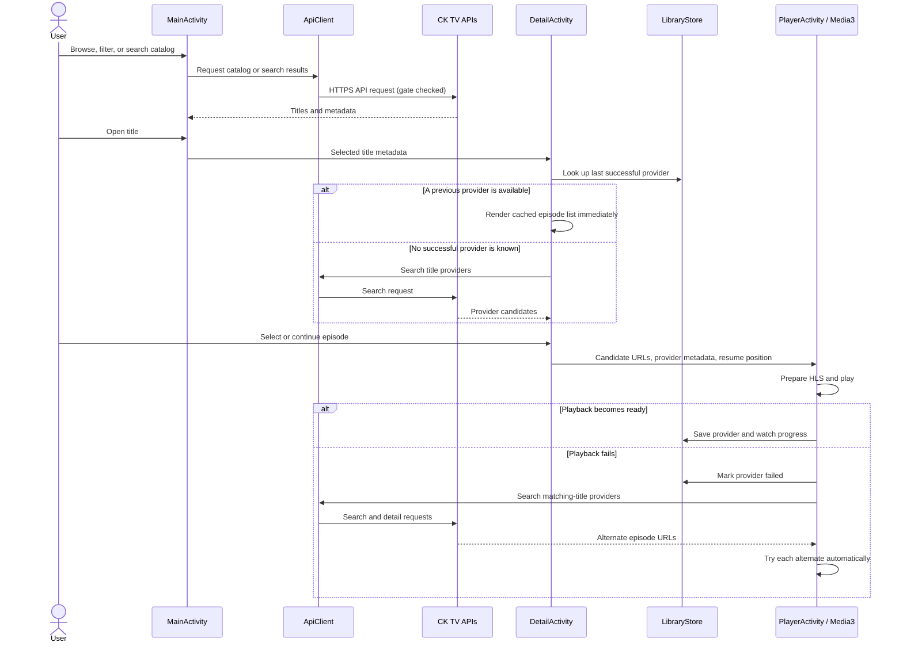
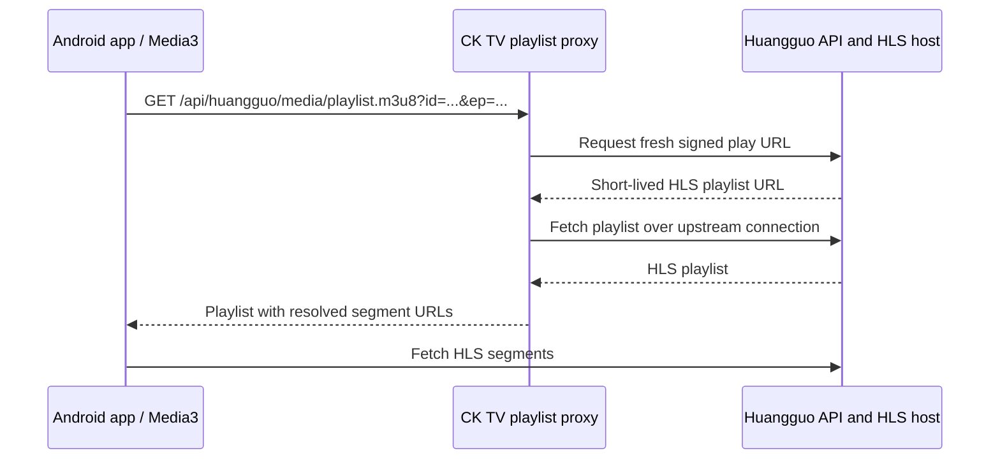

# CKTV Android TV

CKTV Android TV is a native Java client for [CK TV](https://github.com/1837620622/ck_tv),
designed for Android TV boxes and D-pad remotes. It presents CK TV catalogs in
Traditional Chinese, opens playable provider details, and plays HLS streams
with AndroidX Media3.

## Features

- CK TV catalog sections: 電影、劇集、動漫、綜藝、紀錄片、番組、嗶哩、直播、18+專區、AI黃果
- Category, source, subcategory, and live-channel filters where available
- Password/region gate integration for CK TV protected sections
- Remote-friendly catalog, filtering, paging, episode selection, and TV launcher entry
- Adaptive poster cards and explicit vertical D-pad scrolling/focus
- Poster downloads use bounded background work, size-limited image responses,
  sampled decoding, and a capped bitmap cache to reduce memory pressure on TV boxes
- Favorites and history screens focus the first saved item when opened, including on high-resolution Android TV layouts
- Pressing Back/Return on the home screen displays an exit prompt; pressing it again within 2.5 seconds exits the app
- Search, favorites, playback history, and saved episode/position resume
- Favorites store title metadata independently of provider IDs and stream URLs
- Remembers the last provider that reached Media3 `STATE_READY`; reuses its cached
  episode list first and searches other matching-title providers after playback fails
- Manual provider selection remains available
- Huangguo playback uses CK TV's playlist proxy so signed upstream stream URLs are
  refreshed and the playlist is returned through CK TV
- CK TV poster image proxy with direct image fallback
- Full-screen Media3 playback, HLS detection, request headers, playback diagnostics,
  automatic source failover, and remote-friendly controller behavior
- Configurable CK TV base URL and access password

The default CK TV endpoint is `https://tv.chuankangkk.top`. The default gate
password is `cknb666`; the app submits it only to the configured site's
`/api/gate` endpoint when CK TV reports that authentication is required.

## Architecture

### Application components



### Catalog-to-playback flow



### Huangguo stream flow

Huangguo episode entries are CK TV playlist-proxy paths, not stable direct stream
URLs. The app makes them absolute against the configured CK TV base URL. CK TV
then obtains a fresh signed Huangguo URL and returns the playlist through its
proxy, avoiding direct use of expired or access-restricted signed URLs.



## Project layout

```text
.
├── app/
│   ├── build.gradle
│   └── src/main/
│       ├── AndroidManifest.xml
│       ├── java/com/cktv/android/
│       │   ├── ApiClient.java       # CK TV HTTP APIs, gate, cookies, parsing
│       │   ├── DetailActivity.java  # Title details, provider/episode selection
│       │   ├── LibraryStore.java    # Favorites, history, preferred sources, progress
│       │   ├── MainActivity.java    # TV catalog, search, filters, D-pad grid
│       │   ├── MediaItem.java       # Catalog/detail data model
│       │   ├── PlayerActivity.java  # Media3 playback, progress, and failover
│       │   ├── PosterLoader.java    # Image download, validation, and cache
│       │   └── TvUi.java            # Shared TV-friendly UI helpers
│       └── res/                     # App label, icon, banner, and theme
├── build-apk.bat                    # Clean build, lint, and versioned APK output
├── build.gradle                     # Android Gradle plugin declaration
├── gradle/                           # Gradle wrapper
├── gradle.properties
├── settings.gradle
└── README.md
```

## Requirements

- Windows PowerShell or Command Prompt
- JDK 11 or later supported by the configured Android Gradle Plugin
- Android SDK with Android 35 platform and build tools
- Android Gradle Plugin 8.7.3 and Gradle wrapper 8.11.1
- Android TV / Android box with Android 7.0 (API 24) or newer

The build script checks `ANDROID_HOME`, then `ANDROID_SDK_ROOT`, and finally
`C:\xiaoya-android-tools\sdk`.

## Build and validate

From the project directory:

```powershell
.\build-apk.bat
```

The script runs `clean`, `assembleDebug`, and `lintDebug`, then renames the
debug APK using the app version:

```text
app\build\outputs\apk\debug\CKTV-Android-TV-v2.3.0.apk
```

Current app metadata:

- App label: `CKTV Android TV`
- Application ID: `com.cktv.android`
- Version name: `2.3.0`
- Version code: `14`
- Minimum Android API: `24`
- Target / compile SDK: `35`

The generated APK is a debug-signed build for testing and sideloading. A
production release should use a securely managed release signing key rather
than committing signing credentials to the project.

## Playback and history behavior

- Selecting an episode opens the full-screen player.
- HLS URLs are explicitly routed to Media3's HLS implementation. Requests use
  CK TV `Origin`/`Referer` headers.
- If playback fails, the app tries other matching-title providers when their
  episode list is available. For a previously successful provider, the app
  starts with its cached episodes and only searches when that source fails.
- The details page also retains manual provider selection and an explicit
  action to search for more sources.
- Once Media3 reaches `STATE_READY`, the provider is remembered as successful.
- Playback position is saved periodically and when playback stops. Opening an
  entry from **播放記錄** resumes its last saved episode and position. Completed
  playback clears the saved progress.
- Favorites are title records, not provider records; the remembered working
  source is kept separately.

## Settings and privacy

The CK TV base URL and access password can be changed in the app's Settings.
The password is sent to that configured CK TV instance's gate endpoint only
when its gate flow requests authentication. Favorites, history, source
preferences, and playback progress are stored locally with Android
`SharedPreferences`.

## License and upstream

This Android app consumes the public CK TV APIs and playback endpoints. The
upstream CK TV project is [1837620622/ck_tv](https://github.com/1837620622/ck_tv);
consult that project for its license, service terms, and API behavior.
